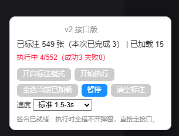

# monkey-scripts

A personal collection of Tampermonkey / Violentmonkey userscripts.

---

## Scripts

### XHS Batch Uncollect — Xiaohongshu Bulk Favorite Remover

Mass-remove favorites (取消收藏) on the Xiaohongshu (RED / 小红书) **web app** without
opening every note one by one. Mark cards straight from the list page, then
batch-uncollect them in the background through the internal API.

- Docs: [English](xhs/README.md) · [中文](xhs/README.zh.md)
- Install: [`xhs/xhs-batch-uncollect.user.js`](xhs/xhs-batch-uncollect.user.js)

---

## Disclaimer

For **personal use only**. Use at your own risk; bulk operations may trigger rate limits
or temporary restrictions on your account.
