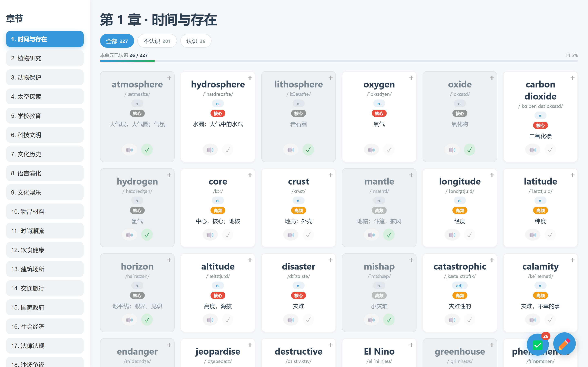

# monkey-scripts

A personal collection of Tampermonkey / Violentmonkey userscripts.

---

## Scripts

### XHS Batch Actions — Unified Xiaohongshu Batch Toolkit

One userscript, one marking workflow, three batch actions: **batch export** (read-only),
**batch uncollect** (write) and **batch unlike** (write, placeholder). They share the same
card selection, queue, speed control and panel — only the action differs. Every write
action asks for confirmation before anything is executed. The panel starts collapsed as a
small pill in the corner; click its title bar to expand it (as shown below). Inside, two
labelled groups — mark and execute — plus a small options row keep the workflow to one
button per action.

- Docs: [English](xhs/README.md) · [中文](xhs/README.zh.md)
- Install: [`xhs/xhs-batch-actions.user.js`](xhs/xhs-batch-actions.user.js) · [Greasy Fork](https://greasyfork.org/en/scripts/605739)

---

### IELTS Vocab Tracker — Familiarity Marking for IELTS Vocabulary

Mark words into configurable groups on the leonwang.cc IELTS vocabulary handout, filter the
grid down to the ones still unknown, and track progress per chapter — or across every chapter
on the spelling practice page, which also hosts the JSON export / import controls. Marks sync
between devices through WebDAV (Nutstore by default), the detail popup hides Chinese by
default for self-testing, and a low-glare dark theme is included.

- Docs: [English](ielts-vocab-tracker/README.md) · [中文](ielts-vocab-tracker/README.zh.md)
- Install: [`ielts-vocab-tracker/ielts-vocab-tracker.user.js`](ielts-vocab-tracker/ielts-vocab-tracker.user.js) · [Greasy Fork](https://greasyfork.org/en/scripts/605737)

---

## Disclaimer

The Xiaohongshu batch script is for **personal use only**; bulk operations may trigger rate
limits or temporary restrictions on your account. The IELTS tracker is unofficial and not
affiliated with leonwang.cc — use it at your own risk.
