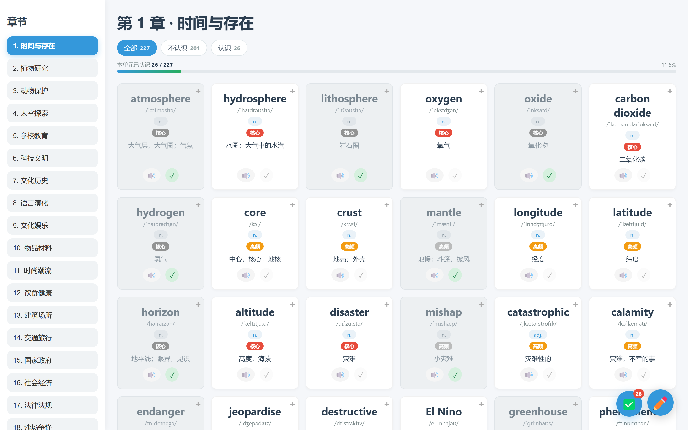

# monkey-scripts

个人的油猴（Tampermonkey / Violentmonkey）脚本集合。

---

## 脚本

### 小红书批量操作助手（统一版）

一个脚本、一套标注交互、三个批量动作：**批量导出文本**（只读）、**批量取消收藏**（写）、
**批量取消点赞**（写，占位）。选卡片、队列、限速、面板全部共用，只是动作不同；
所有写操作在执行前都会先弹对话框确认。

- 文档：[中文](xhs/README.zh.md) · [English](xhs/README.md)
- 安装：[`xhs/xhs-batch-actions.user.js`](xhs/xhs-batch-actions.user.js)

---

### 雅思词汇掌握度助手

在 leonwang.cc 的雅思词汇页上标记「已认识」的单词，按认识程度筛选，并查看每个单元的掌握进度；
刷词页还会显示全部单元的总进度，并提供 JSON 导出 / 导入入口。详情弹窗默认隐藏中文，方便只看
英文自测，另外支持深色主题。

- 文档：[中文](ielts-vocab-tracker/README.zh.md) · [English](ielts-vocab-tracker/README.md)
- 安装：[`ielts-vocab-tracker/ielts-vocab-tracker.user.js`](ielts-vocab-tracker/ielts-vocab-tracker.user.js)

---

## 免责声明

仅供**个人使用**。使用风险自负；批量操作可能触发限流或临时封禁。
