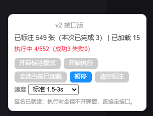

# monkey-scripts

个人的油猴（Tampermonkey / Violentmonkey）脚本集合。

---

## 脚本

### 小红书收藏批量取消助手（接口版）

在**网页版**小红书上批量取消收藏，不用再一张一张点开笔记去取消。直接在列表页标注卡片，
然后在后台通过官方内部接口批量取消。

- 文档：[中文](xhs/README.zh.md) · [English](xhs/README.md)
- 安装：[`xhs/xhs-batch-uncollect.user.js`](xhs/xhs-batch-uncollect.user.js)

---

### 雅思词汇掌握度助手

在 leonwang.cc 的雅思词汇页上标记「已认识」的单词，按认识程度筛选，并查看每个单元的掌握进度。
详情弹窗默认隐藏中文，方便只看英文自测；标记状态可以导出 / 导入 JSON 备份，并支持深色主题。

- 文档：[中文](ielts-vocab-tracker/README.zh.md) · [English](ielts-vocab-tracker/README.md)
- 安装：[`ielts-vocab-tracker/ielts-vocab-tracker.user.js`](ielts-vocab-tracker/ielts-vocab-tracker.user.js)

---

## 免责声明

仅供**个人使用**。使用风险自负；批量操作可能触发限流或临时封禁。
