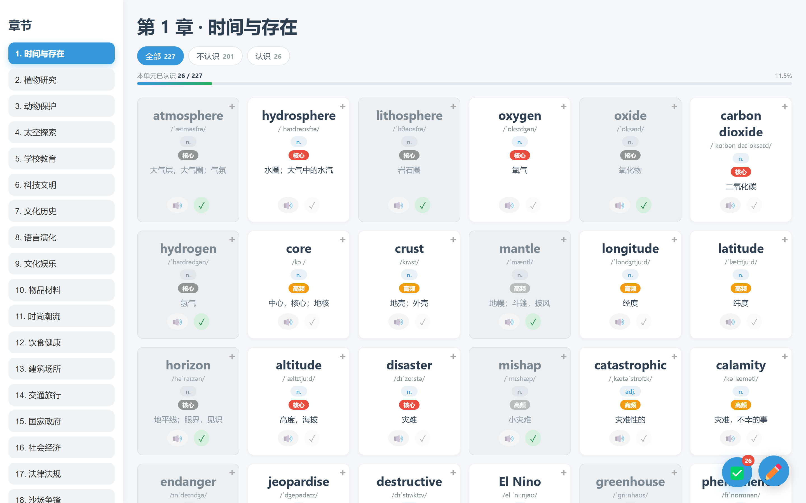
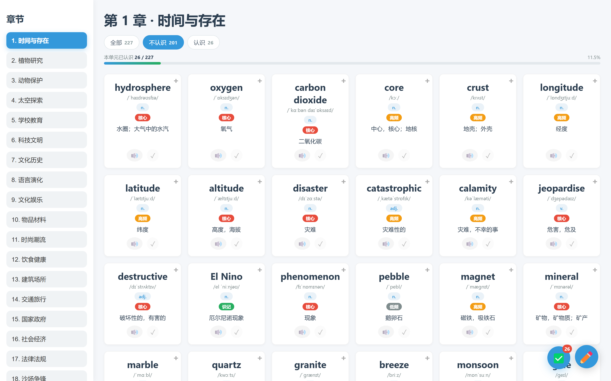
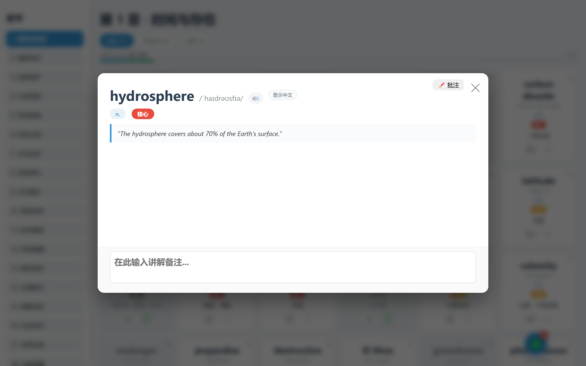
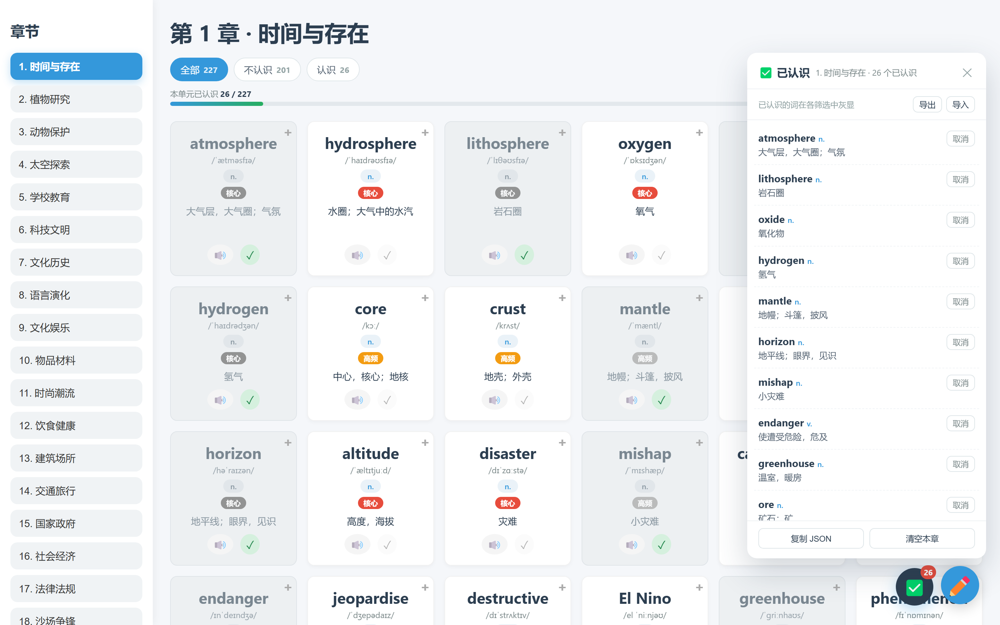
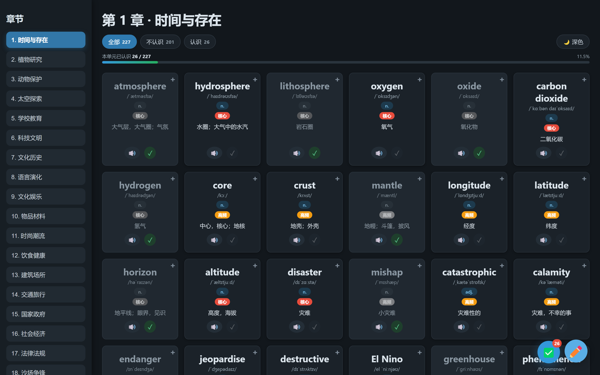
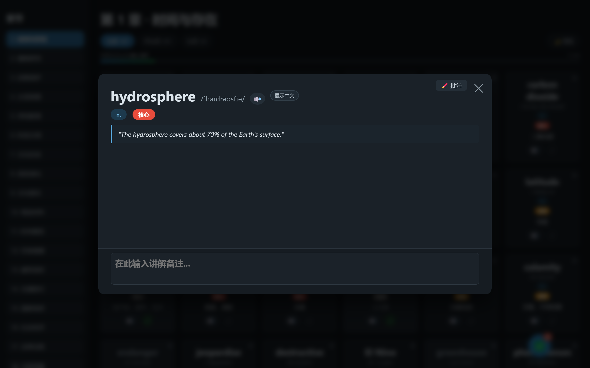

# IELTS Vocab Tracker — Familiarity Marking for IELTS Vocabulary

A Tampermonkey / Violentmonkey userscript for the IELTS vocabulary pages on
[leonwang.cc](https://www.leonwang.cc/ielts-vocab/index.html). Mark words into configurable
groups, filter the grid down to what you still need, hide the Chinese while you review,
watch per-chapter and overall progress bars fill up, and sync your marks across devices
through WebDAV (Nutstore / 坚果云 by default).

> Works on `https://www.leonwang.cc/ielts-vocab/*`, desktop and mobile.

---

## Why this exists

The handout shows every word the same way, and its detail popup always reveals the Chinese
meaning and example translation. Reviewing 200+ words per topic that way is slow: you spend
time on words you already know, and the translation spoils the test. This script adds a
layer of familiarity tracking on top of the existing page — it does not rewrite the site's
content or data.

---

## Features

- **Configurable groups.** Two groups ship by default — `🎤 发音` (pronunciation) and
  `✓ 认识` (known) — and you can add, rename, re-icon, hide, reorder, or delete groups in
  the ⚙ settings panel. Each group gets its own colour on the cards and its own filter chip.
- **One-click marking.** Every card gets one button per visible group. Clicking marks the
  word into that group; clicking the same button again unmarks it. Marked cards stay in
  place, tinted with the group colour.
- **Dynamic filters.** `全部` (all) / `不认识` (unknown) plus one chip per visible group, each
  with a live count. The filter is a view setting only and always resets to **全部** after a
  reload.
- **Per-chapter progress.** A sticky bar above the grid counts the words in groups marked
  `计入` (by default only `认识`) and shows `known / total` plus a percentage for the current
  chapter.
- **Overall progress.** The spelling practice page shows one bar covering every chapter
  (`known / all words` plus a percentage). Word counts are read from the chapter data the
  site already caches, so there is no extra download.
- **Chinese hidden by default.** Opening a word shows only the English example; a
  `显示中文` button reveals the meaning, translation, word root, and extra notes. It resets to
  hidden on every open, including keyboard navigation.
- **Dark theme.** A theme pill next to the filters cycles Auto → Dark → Light. Auto follows
  the operating system, and the choice is remembered on that device only.
- **Marked-words panel.** The ✅ button opens a list of every marked word in the current
  chapter, grouped by colour, with one-click removal and a `清空本章` button.
- **WebDAV sync.** Push, pull, or merge your marks with a single JSON file on any WebDAV
  server — Nutstore comes preconfigured. Optional automatic sync on a 0/1/5/15-minute
  schedule, on page load, and after every change.
- **Export / import.** On the practice page, back up all chapters to JSON, copy it to the
  clipboard, or import and merge it on another browser.
- **Per-chapter isolation.** Marks are stored per chapter, so switching topics always shows
  the right set.
- **Survives re-renders.** Switching chapters, uploading an image, or any other page redraw
  reapplies the state automatically.

---

## Screenshots

The filter bar and progress bar sit above the grid; marked cards keep their place but take
on their group's colour.



Switch to `不认识` to see only the words you still need to learn.



The detail popup hides Chinese by default — the English example is enough to test yourself.



The ✅ panel lists everything marked in the current chapter and lets you remove single
entries.



---

## Dark theme

For late-night review the whole page switches to a low-glare dark palette; the detail popup
and the marked-words panel follow suit. The theme pill sits next to the filters and cycles
Auto → Dark → Light. Auto follows the operating system, and the choice is saved per device,
so your phone can stay dark while the desktop stays light.





---

## Install

1. Install a userscript manager in your browser:
   - [Tampermonkey](https://www.tampermonkey.net/) (Chrome / Edge / Firefox / Safari)
   - or [Violentmonkey](https://violentmonkey.github.io/).
2. Add `ielts-vocab-tracker.user.js`:
   - **Tampermonkey** → Dashboard → Utilities → *Import* (pick the file), **or**
   - create a new script, paste the file contents, and save.
3. Open the vocabulary handout for the per-chapter UI, or the spelling practice page for the
   overall progress and JSON backup controls.

On Android, use a mobile browser that supports extensions (for example Edge Canary or
Firefox for Android) plus Tampermonkey / Violentmonkey, then import the same file. The UI
is responsive: the filter bar sticks below the mobile header, and the marked-words panel
opens full width.

Before installing an update, export a backup; the store is versioned and existing marks are
kept, but a JSON file is the safest rollback.

---

## Usage

| Control | What it does |
| --- | --- |
| ⚙ (next to the filters) | Open the settings panel: groups and WebDAV sync. |
| Group button on a card | Mark the word into that group. Click the active one again to unmark. |
| `全部` / `不认识` / group chips | Filter the grid. The counts next to each label update live. |
| Progress bar | Words in counting groups ÷ total words for the chapter, with the percentage on the right. |
| Overall bar (practice page) | Words in counting groups ÷ all words across chapters, with the percentage; sits below the session stats. |
| `🌗 自动` / `🌙 深色` / `☀️ 浅色` | Cycle the theme. Auto follows the system; the choice is remembered on this device. |
| ✅ launcher (bottom-right) | Open the marked-words panel for the current chapter. |
| `显示中文` / `隐藏中文` | Toggle the Chinese content in the detail popup. |
| `导出` / `导入` / `复制 JSON` (practice page) | Download, merge-import, or copy all chapters as JSON. |
| `清空本章` (marked-words panel) | Remove every mark in the current chapter (asks for confirmation). |
| `＋ 新建分组` (settings) | Add a group with its own icon, colour, and counting flag. |
| `⋮⋮` / 👁 / 🗑 / `计入` (settings) | Reorder, hide, delete a group, or include it in the progress bars. |

Notes:

- Group order in the settings panel is also the order of card buttons and filter chips.
- Deleting a group removes the marks that belong to it (after a confirmation showing how
  many).
- The `认识` group cannot be deleted; it is the default counted group.
- With a group filter active, unmarking the last card makes it disappear immediately — that
  is expected. Switch back to `全部` to keep marking.
- The filter choice is not persisted; marks and settings are.

---

## WebDAV sync

Sync keeps one JSON file on the server and merges it into every device. It is off until you
fill in credentials, so a fresh install never sends anything anywhere.

### Nutstore setup

1. In Nutstore, create a folder (the default path expects `IELTS/`) and make sure the folder
   exists — a missing folder returns HTTP 404.
2. Go to Nutstore → *Account information* → *Security* → *Third-party app management* and
   create an **app password**. Use this password, not your login password.
3. Open ⚙ → *云同步 · WebDAV*, keep or replace the pre-filled address:
   `https://dav.jianguoyun.com/dav/IELTS/ielts-vocab-tracker.json`
4. Enter your Nutstore account (email) and the app password.
5. Click `立即同步` once. The first run creates the file on the server.

The address field always falls back to the default path when cleared, so you can use it
as-is or point it at your own folder / another WebDAV server.

### Scheduling

| Setting | Effect |
| --- | --- |
| `同步频率` = `0 分钟 · 不自动同步` | No timed sync and no sync after edits. Only the three buttons sync. |
| `每 1 / 5 / 15 分钟` | Poll the cloud on that interval, and sync ~2.5 s after a local change. |
| `刷新页面后自动同步一次` | Runs one merge sync shortly after page load. Independent of the frequency. |

Automatic sync (boot, interval, or after a change) only starts once an account or password
is configured; the manual buttons are always available.

### The three buttons

- `立即同步` — download, merge both ways, then upload. The usual choice.
- `仅下载` — download and merge locally, without uploading. Fails if the cloud file does not
  exist yet.
- `覆盖上传` — replace the cloud file with this device's data. Asks for confirmation; marks
  that exist only in the cloud are lost.

### Merge rules

- **Words:** if both sides have a word, the one with the newer `updatedAt` wins; remote-only
  words are added locally, local-only words are kept and uploaded.
- **Groups:** merged by group id, newer `updatedAt` wins; local group order is preserved and
  remote-only groups are appended.
- **Offline edits:** timestamps are stored per word, so two devices editing different words
  do not overwrite each other.

### Privacy

- Credentials live in this browser's `localStorage` on this device and are **not** written to
  exported JSON or to the cloud file.
- Requests go only to the WebDAV URL you configure, with HTTP Basic auth, so use an HTTPS
  address. The script asks for `@connect *` because WebDAV hosts are arbitrary.
- Clearing site data removes the credentials too.

### Known limitation

Deletions are not propagated by merge: unmarking a word removes it locally, but if the cloud
file (or another device) still has it, the next merge brings it back. To remove a word
everywhere, unmark it on the device that syncs last, or use `覆盖上传` from a cleaned-up
device. Timestamped tombstones are not implemented yet.

---

## How state is stored

Everything lives in `localStorage` under the key `ielts-vocab-bag.v1` (the legacy name is
kept so marks made before the rename survive). Nothing is uploaded unless you enable sync.

```json
{
  "version": 2,
  "updatedAt": "2026-11-16T08:00:00.000Z",
  "settings": {
    "groups": [
      { "id": "pron", "name": "发音", "icon": "🎤", "visible": true, "counts": false, "color": 1 },
      { "id": "known", "name": "认识", "icon": "✓", "visible": true, "counts": true, "color": 0 }
    ],
    "sync": {
      "url": "https://dav.jianguoyun.com/dav/IELTS/ielts-vocab-tracker.json",
      "user": "you@example.com",
      "pass": "app-password",
      "freq": "5",
      "bootSync": true,
      "lastAt": "2026-11-16T08:00:00.000Z",
      "lastStatus": "ok"
    }
  },
  "chapters": {
    "1": {
      "atmosphere": {
        "word": "atmosphere",
        "pos": "n.",
        "meaning": "大气层，大气圈；气氛",
        "addedAt": "2026-11-09T04:00:00.000Z",
        "updatedAt": "2026-11-09T04:00:00.000Z",
        "group": "known"
      }
    }
  }
}
```

`导出` wraps the chapters and groups in an envelope with `app`, `version`, `exportedAt`, and
`chapterTitles` for friendly names; the `sync` block (credentials included) is deliberately
left out. Import **merges**: existing words and groups are kept, new ones are added.

Two more local keys are used, neither of which is user content:

- `ielts-vocab-tracker.totals.v1` — cached word counts per chapter, used for the overall
  percentage. They are read from the site's own cached `data-*.js` files and refreshed when
  the site's cache version changes; a built-in snapshot is the fallback.
- `ielts-vocab-tracker.theme.v1` — the Auto / Dark / Light choice for this device.

Clearing the browser's site data removes the marks and the sync credentials, so export a
backup first.

---

## Compatibility / tweaking

- Match rule: `https://www.leonwang.cc/ielts-vocab/*`.
- The script integrates through a few stable page anchors: `#cardGrid`, `.card .word`,
  `.card .pos`, `.card .meaning`, `.card-actions`, `.overlay-content`,
  `.sidebar button[data-chapter]`, `#mobileChapterSelect` on the handout, and `.stats` on the
  practice page.
- Overall word counts come from `/ielts-vocab/data-<chapter>.js` in the site's
  service-worker cache; if those files move, only the fallback counts are used.
- All injected UI uses the `vb-` prefix. If the site is redesigned and cards stop being
  recognised, those anchors are what need updating.
- Marking a card in `全部` or `不认识` works even while the grid is scrolled; state is keyed
  by chapter id + the trimmed word text.
- Group ids are generated once and not derived from the name, so renaming a group does not
  orphan its marks.

---

## Buy Me a Coffee · 打赏

If this script saves you some review time, a small tip is welcome — scan the Alipay code
below.


---

## Files in this folder

| File | Purpose |
| --- | --- |
| `ielts-vocab-tracker.user.js` | The main userscript. Install this. |
| `README.md` | This file (English). |
| `README.zh.md` | 中文说明。 |

---

## Disclaimer

Unofficial and not affiliated with leonwang.cc. Use at your own risk. Sync writes to your
own WebDAV storage; you are responsible for the data you put there.
