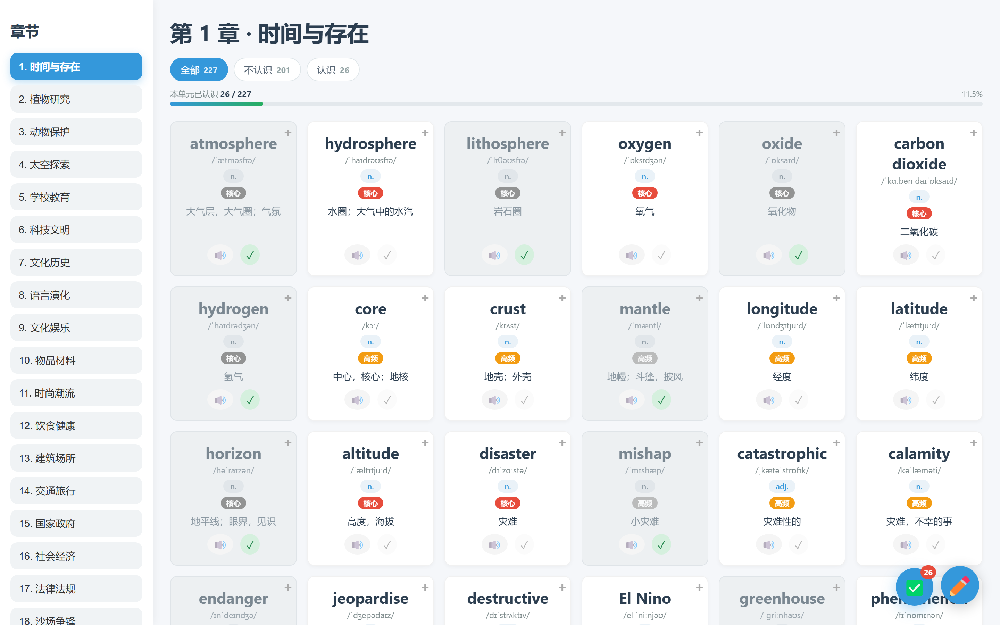
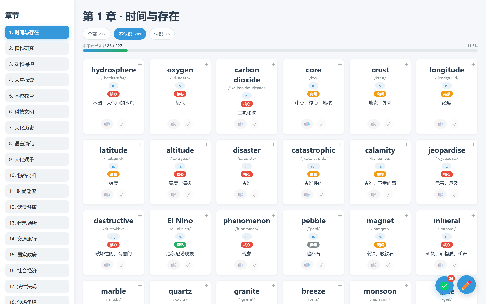
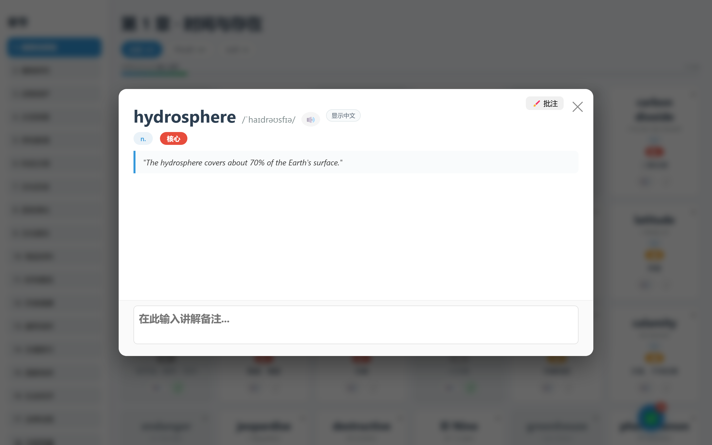
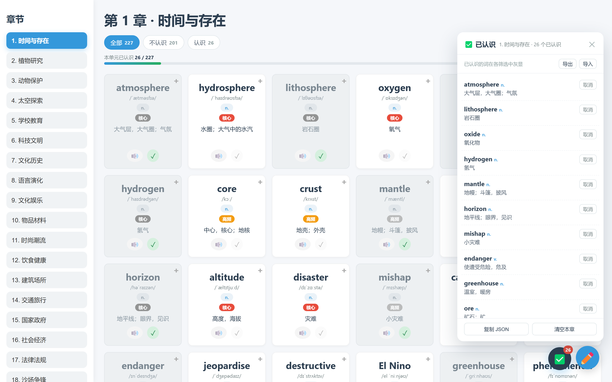

# IELTS Vocab Tracker — Familiarity Marking for IELTS Vocabulary

A Tampermonkey / Violentmonkey userscript for the IELTS vocabulary handout on
[leonwang.cc](https://www.leonwang.cc/ielts-vocab/handout.html). Mark the words you already
know, filter the grid down to the ones you still need, hide the Chinese while you review,
and watch a per-chapter progress bar fill up.

> Works on `https://www.leonwang.cc/ielts-vocab/*`, desktop and mobile.

---

## Why this exists

The handout shows every word the same way, and its detail popup always reveals the Chinese
meaning and example translation. Reviewing 200+ words per topic that way is slow: you spend
time on words you already know, and the translation spoils the test. This script adds a
layer of familiarity tracking on top of the existing page — it does not rewrite the site's
content or data.

---

## Features

- **One-click "known" marking.** Click the ✓ on a card to mark it. The card stays where it
  is and turns grey, so the layout and your scroll position never jump.
- **Three filters.** `全部` (all) / `不认识` (unknown) / `认识` (known). The filter is a
  per-session view setting and always starts at **全部** after a reload.
- **Per-chapter progress.** A sticky bar above the grid shows `known / total` and a
  percentage for the current chapter.
- **Chinese hidden by default.** Opening a word shows only the English example; a
  `显示中文` button reveals the meaning, translation, word root, and extra notes. It resets to
  hidden on every open, including keyboard navigation.
- **Known-words panel.** The ✅ button opens a list of every marked word in the current
  chapter, with one-click removal.
- **Export / import.** Back up all chapters to JSON, copy it to the clipboard, or import and
  merge it on another browser.
- **Per-chapter isolation.** Marks are stored per chapter, so switching topics always shows
  the right set.
- **Survives re-renders.** Switching chapters, uploading an image, or any other page redraw
  reapplies the state automatically.

---

## Screenshots

The filter bar and progress bar sit above the grid; known cards keep their place but turn
grey with a green check.



Switch to `不认识` to see only the words you still need to learn.



The detail popup hides Chinese by default — the English example is enough to test yourself.



The ✅ panel lists everything marked in the current chapter and doubles as the export /
import entry point.



---

## Install

1. Install a userscript manager in your browser:
   - [Tampermonkey](https://www.tampermonkey.net/) (Chrome / Edge / Firefox / Safari)
   - or [Violentmonkey](https://violentmonkey.github.io/).
2. Add `ielts-vocab-tracker.user.js`:
   - **Tampermonkey** → Dashboard → Utilities → *Import* (pick the file), **or**
   - create a new script, paste the file contents, and save.
3. Open the vocabulary handout. The filter/progress bar appears above the cards.

---

## Usage

| Control | What it does |
| --- | --- |
| ✓ on a card | Mark / unmark the word as known. Known cards turn grey but stay in the grid. |
| `全部` / `不认识` / `认识` | Filter the grid. The counts next to each label update live. |
| Progress bar | Known words ÷ total words for the chapter, with the percentage on the right. |
| ✅ launcher (bottom-right) | Open the known-words panel for the current chapter. |
| `显示中文` / `隐藏中文` | Toggle the Chinese content in the detail popup. |
| `导出` | Download all chapters as a JSON file. |
| `导入` | Pick a JSON file and merge it into the current data. |
| `复制 JSON` | Copy the export payload to the clipboard. |
| `清空本章` | Remove every mark in the current chapter (asks for confirmation). |

Notes:

- With the `认识` filter active, unmarking the last card makes it disappear immediately —
  that is expected. Switch back to `全部` to keep marking.
- The filter choice is not persisted; marks are.

---

## How state is stored

Everything lives in `localStorage` under the key `ielts-vocab-bag.v1` (the legacy name is
kept so marks made before the rename survive). Nothing is sent anywhere.

```json
{
  "version": 1,
  "chapters": {
    "1": {
      "atmosphere": {
        "word": "atmosphere",
        "pos": "n.",
        "meaning": "大气层，大气圈；气氛",
        "addedAt": "2026-11-09T04:00:00.000Z"
      }
    }
  }
}
```

`导出` wraps this in a small envelope with `app`, `version`, `exportedAt`, and
`chapterTitles` so an import can show friendly names. Import **merges**: existing words are
kept, new ones are added.

Clearing the browser's site data removes the marks, so export a backup first.

---

## Compatibility / tweaking

- Match rule: `https://www.leonwang.cc/ielts-vocab/*`.
- The script integrates through a few stable page anchors: `#cardGrid`, `.card .word`,
  `.card .pos`, `.card .meaning`, `.card-actions`, `.overlay-content`, and
  `.sidebar button[data-chapter]`.
- All injected UI uses the `vb-` prefix. If the site is redesigned and cards stop being
  recognised, those anchors are what need updating.
- Marking a card in `全部` or `不认识` works even while the grid is scrolled; state is keyed
  by chapter id + the trimmed word text.

---

## Files in this folder

| File | Purpose |
| --- | --- |
| `ielts-vocab-tracker.user.js` | The main userscript. Install this. |
| `README.md` | This file (English). |
| `README.zh.md` | 中文说明。 |

---

## Disclaimer

For **personal use only**. Not affiliated with leonwang.cc. Use at your own risk.
