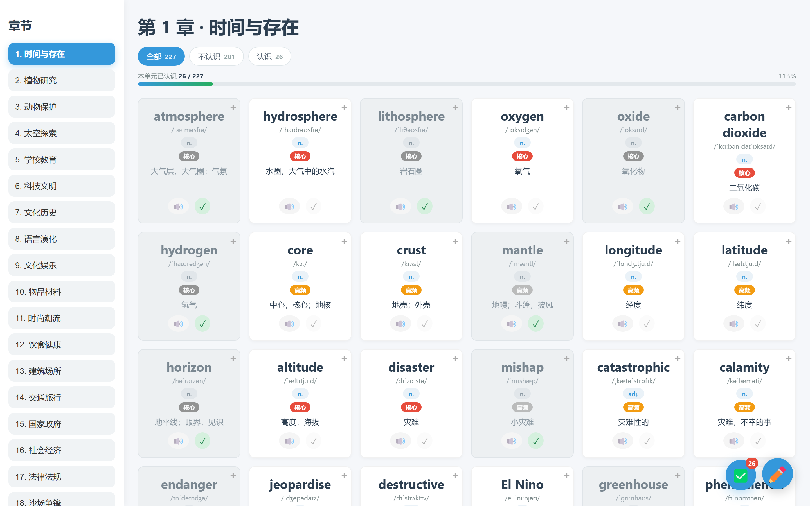
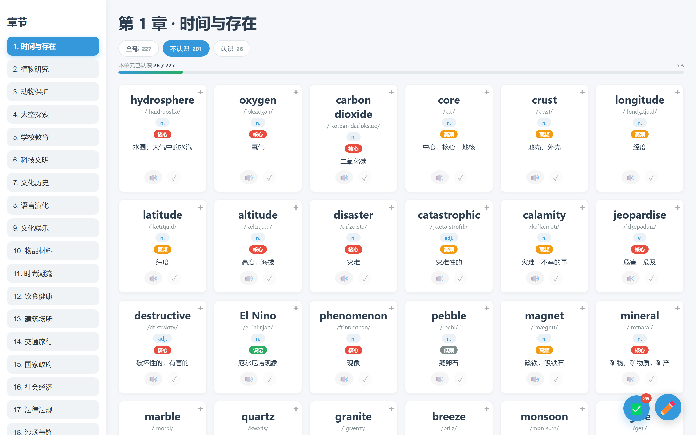
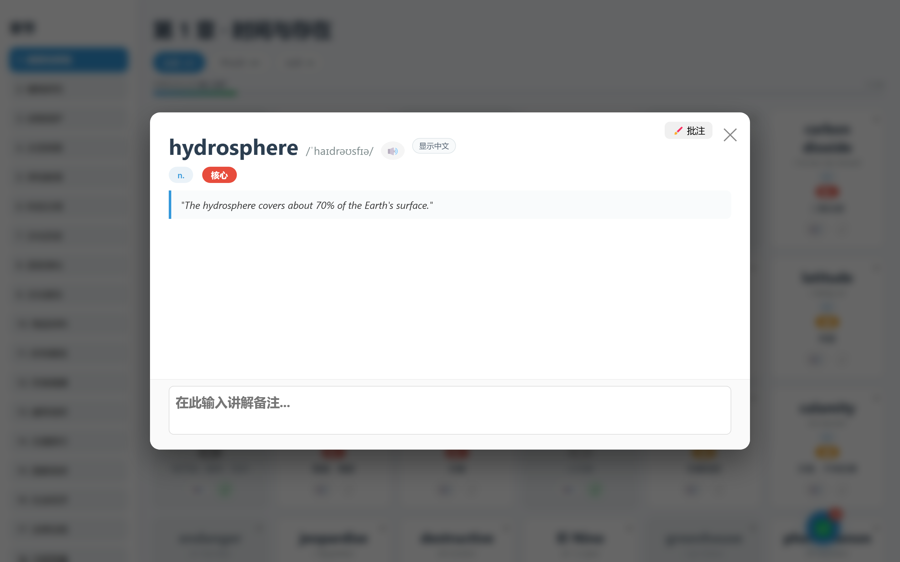
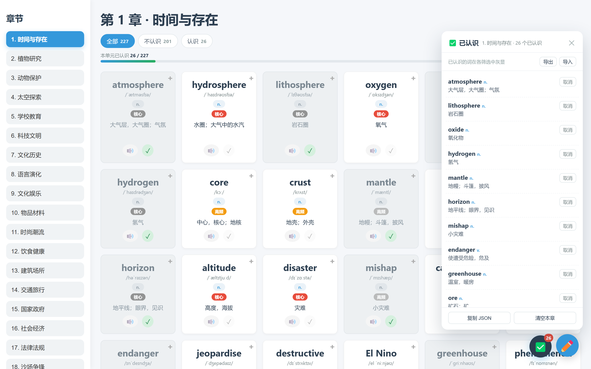

# 雅思词汇掌握度助手

一个 Tampermonkey / Violentmonkey 油猴脚本，给 [leonwang.cc](https://www.leonwang.cc/ielts-vocab/handout.html)
的雅思词汇卡片加上「已认识」标记、三档筛选与本单元进度条。复习时可以先隐藏中文，只靠英文例句
自测；不想再看的单词一键标记后变灰留在原位，状态可以导出备份。

> 适用于 `https://www.leonwang.cc/ielts-vocab/*`，桌面端和手机端都可以用。

---

## 为什么需要它

词汇页每张卡片长得都一样，点开详情又会直接露出中文释义和例句翻译。一个单元动辄两百多个词，
这样复习很浪费时间：既会在已经认识的词上反复停留，也会被翻译提前剧透。这个脚本只在现有页面上
叠加一层「掌握度」逻辑，不改动站点本身的内容和数据。

---

## 功能

- **一键标记已认识。** 点卡片上的 ✓ 即可标记。卡片不会消失，而是变灰留在原位，版式和滚动位置都不会跳动。
- **三档筛选。** `全部` / `不认识` / `认识`，每个标签旁边实时显示数量。筛选只是当前页面的视图状态，刷新后总是回到**全部**。
- **本单元进度条。** 卡片网格上方固定一条进度条，显示当前单元的 `已认识 / 总数` 和百分比。
- **默认隐藏中文。** 打开单词详情时只显示英文例句；点 `显示中文` 才会展开释义、例句翻译、词根和补充内容。每次打开（包括用键盘切换单词）都会重置为隐藏。
- **已认识面板。** 右下角 ✅ 按钮打开当前单元的已认识单词列表，可以单个移出。
- **导出 / 导入。** 把所有单元的状态备份为 JSON，或复制到剪贴板，也可以在另一个浏览器导入合并。
- **按单元隔离。** 标记按章节分别存储，切换单元时看到的一定是这一章自己的状态。
- **抗页面重绘。** 切换单元、上传图片等任何导致卡片重绘的操作之后，状态都会自动重新套用。

---

## 界面截图

筛选条和进度条固定在卡片上方；已认识的卡片留在原位，变成灰色并带绿色 ✓。



切到 `不认识`，只看还没掌握的词。



详情弹窗默认隐藏中文，只留英文例句方便自测。



✅ 面板列出当前单元所有已标记的单词，同时也是导出 / 导入的入口。



---

## 安装

1. 在浏览器中安装脚本管理器：
   - [Tampermonkey 油猴](https://www.tampermonkey.net/)（Chrome / Edge / Firefox / Safari）
   - 或 [Violentmonkey](https://violentmonkey.github.io/)。
2. 添加 `ielts-vocab-tracker.user.js`：
   - **油猴** → 管理面板 → 实用工具 → 导入（选择文件），**或**
   - 新建脚本，把文件内容粘贴进去并保存。
3. 打开词汇页，卡片上方就会出现筛选条和进度条。

---

## 使用方法

| 控件 | 作用 |
| --- | --- |
| 卡片上的 ✓ | 标记 / 取消标记「已认识」。已认识的卡片变灰，但仍留在网格里。 |
| `全部` / `不认识` / `认识` | 切换筛选，标签旁的数字实时更新。 |
| 进度条 | 当前单元已认识词数 ÷ 总词数，右侧显示百分比。 |
| 右下角 ✅ 按钮 | 打开当前单元的已认识单词面板。 |
| `显示中文` / `隐藏中文` | 在详情弹窗里切换中文内容。 |
| `导出` | 把所有单元的状态下载为 JSON 文件。 |
| `导入` | 选择 JSON 文件并合并进当前数据。 |
| `复制 JSON` | 把导出内容复制到剪贴板。 |
| `清空本章` | 清除当前单元的全部标记（会先确认）。 |

说明：

- 在 `认识` 筛选下取消最后一个标记时，卡片会立刻消失，这是正常的；要连续标记请切回 `全部`。
- 筛选状态不会被保存，标记会被保存。

---

## 数据存储

所有数据都保存在 `localStorage` 的 `ielts-vocab-bag.v1` 键下（沿用旧名字，保证改名前标记过的词不会丢失），不会上传到任何地方。

```json
{
  "version": 1,
  "chapters": {
    "1": {
      "atmosphere": {
        "word": "atmosphere",
        "pos": "n.",
        "meaning": "大气层，大气圈；气氛",
        "addedAt": "2026-11-09T04:00:00.000Z"
      }
    }
  }
}
```

`导出` 会在这个结构外面套一层包含 `app`、`version`、`exportedAt` 和 `chapterTitles` 的信封，方便导入时显示章节名。导入是**合并**：已有单词保持不动，只补充新的。

清除浏览器站点数据会一并清掉标记，建议先导出一份备份。

---

## 兼容性 / 自定义

- 匹配规则：`https://www.leonwang.cc/ielts-vocab/*`。
- 脚本依赖几个稳定的页面锚点：`#cardGrid`、`.card .word`、`.card .pos`、`.card .meaning`、`.card-actions`、`.overlay-content` 和 `.sidebar button[data-chapter]`。
- 所有注入的界面元素都使用 `vb-` 前缀。如果网站改版导致卡片识别不到，需要更新的就是上述锚点。
- 标记以「章节 id + 去空格后的单词文本」为键，所以在 `全部` 或 `不认识` 视图下滚动着标记都不会错位。

---

## 本目录文件说明

| 文件 | 用途 |
| --- | --- |
| `ielts-vocab-tracker.user.js` | 主脚本，安装这个即可。 |
| `README.md` | 英文说明。 |
| `README.zh.md` | 本文件（中文）。 |

---

## 免责声明

仅供**个人使用**。与 leonwang.cc 官方无关，使用风险自负。
