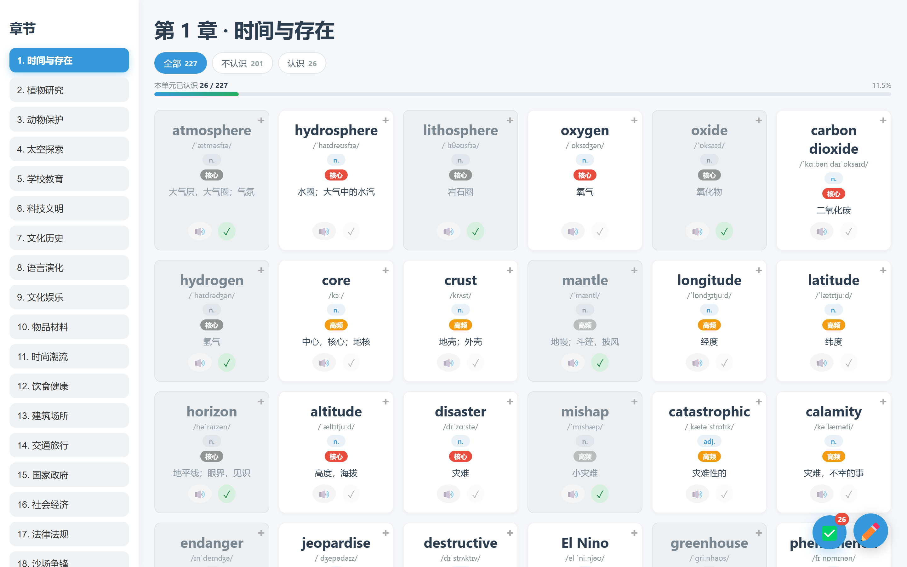
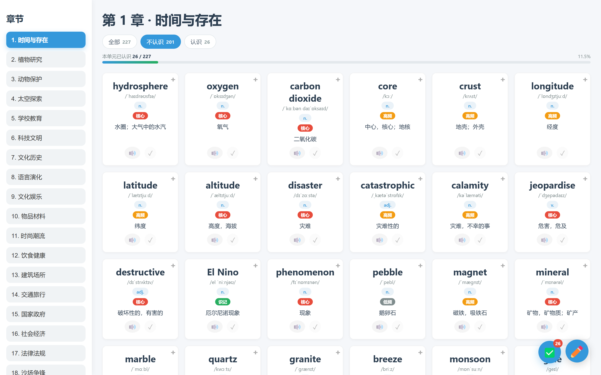
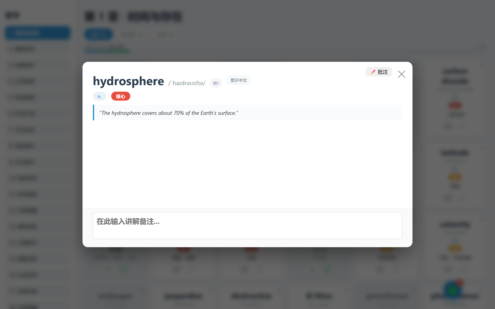
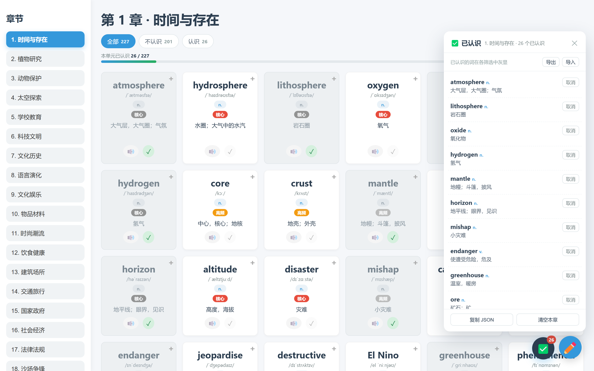
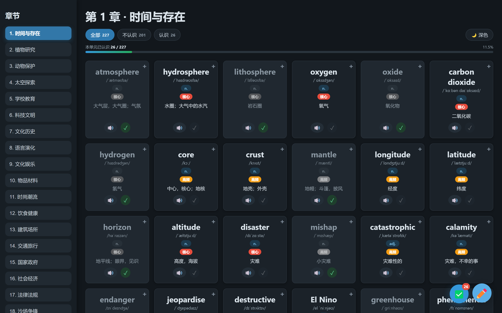
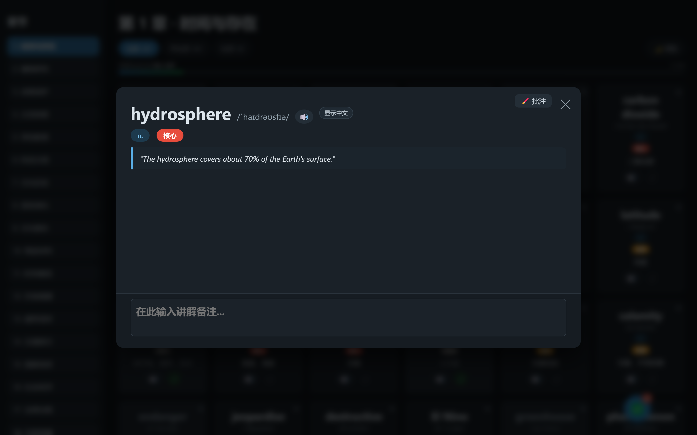

# 雅思词汇掌握度助手

一个 Tampermonkey / Violentmonkey 油猴脚本，给 [leonwang.cc](https://www.leonwang.cc/ielts-vocab/index.html)
的雅思词汇页面加上可配置分组标记、分组筛选、本单元与全站进度条，并可通过 WebDAV（默认坚果云）
在多台设备之间同步。复习时可以先隐藏中文，只靠英文例句自测；不想再看的单词一键标记后染色
留在原位。

> 适用于 `https://www.leonwang.cc/ielts-vocab/*`，桌面端和手机端都可以用。

---

## 为什么需要它

词汇页每张卡片长得都一样，点开详情又会直接露出中文释义和例句翻译。一个单元动辄两百多个词，
这样复习很浪费时间：既会在已经认识的词上反复停留，也会被翻译提前剧透。这个脚本只在现有页面上
叠加一层「掌握度」逻辑，不改动站点本身的内容和数据。

---

## 功能

- **可配置分组。** 默认带 `🎤 发音` 和 `✓ 认识` 两组，可在 ⚙ 设置里新建、改名、换图标、隐藏、拖动排序或删除。每组有自己的卡片颜色和筛选标签。
- **一键标记。** 每张卡片都会出现当前所有可见分组的按钮；点一下标记进该组，再点同一个按钮取消。被标记的卡片留在原位，并染上分组颜色。
- **动态筛选。** `全部` / `不认识` 加上每个可见分组各一个标签，数字实时更新。筛选只是当前页面的视图状态，刷新后总是回到**全部**。
- **本单元进度条。** 卡片网格上方固定一条进度条，统计勾选了「计入」的分组（默认只有 `认识`），显示当前单元的 `已认识 / 总数` 和百分比。
- **全站总进度。** 刷词页在「进度 / 正确 / 错误」下方显示覆盖全部单元的总进度（`已认识 / 全部单词` 加百分比）。各单元词数直接读取站点已缓存的章节数据，不会额外下载。
- **默认隐藏中文。** 打开单词详情时只显示英文例句；点 `显示中文` 才会展开释义、例句翻译、词根和补充内容。每次打开（包括用键盘切换单词）都会重置为隐藏。
- **深色主题。** 筛选条右侧的主题按钮在「自动 → 深色 → 浅色」之间循环；自动跟随系统，选择只保存在当前设备。
- **已标记面板。** 右下角 ✅ 按钮打开当前单元的全部标记列表，按分组上色，可以单个移出或一键 `清空本章`。
- **WebDAV 同步。** 把标记和任意 WebDAV 服务上的一个 JSON 文件互推、合并；坚果云地址已预填。可选每 0/1/5/15 分钟自动同步、刷新页面自动同步一次、改动后自动同步。
- **导出 / 导入。** 在刷词页把全部单元备份为 JSON、复制到剪贴板，也可以在另一个浏览器导入合并。
- **按单元隔离。** 标记按章节分别存储，切换单元时看到的一定是这一章自己的状态。
- **抗页面重绘。** 切换单元、上传图片等任何导致卡片重绘的操作之后，状态都会自动重新套用。

---

## 界面截图

筛选条和进度条固定在卡片上方；被标记的卡片留在原位，染上所属分组的颜色。



切到 `不认识`，只看还没掌握的词。



详情弹窗默认隐藏中文，只留英文例句方便自测。



✅ 面板列出当前单元的全部标记，可以逐条取消。



---

## 深色主题

晚上复习时整页会切换成低亮度、低眩光的深色配色，详情弹窗和已标记面板也一并适配。筛选条右侧的主题按钮按「自动 → 深色 → 浅色」循环；自动跟随系统，选择只保存在当前设备，手机和电脑可以各自不同。





---

## 安装

1. 在浏览器中安装脚本管理器：
   - [Tampermonkey 油猴](https://www.tampermonkey.net/)（Chrome / Edge / Firefox / Safari）
   - 或 [Violentmonkey](https://violentmonkey.github.io/)。
2. 添加 `ielts-vocab-tracker.user.js`：
   - **油猴** → 管理面板 → 实用工具 → 导入（选择文件），**或**
   - 新建脚本，把文件内容粘贴进去并保存。
3. 打开词汇卡片页可以看到筛选条和本单元进度条；打开刷词页可以看到总进度和 JSON 备份入口。

手机上用支持扩展的浏览器（例如 Edge Canary、Firefox for Android）配合 Tampermonkey /
Violentmonkey，导入同一个文件即可。界面已做响应式处理：筛选条贴在移动端顶栏下方，已标记面板
占满整行宽度。

升级脚本前建议先导出一份 JSON；数据结构有版本号、旧标记会保留，但文件备份最稳妥。

---

## 使用方法

| 控件 | 作用 |
| --- | --- |
| 筛选条旁的 ⚙ | 打开设置面板：分组与 WebDAV 同步。 |
| 卡片上的分组按钮 | 把单词标记进该分组。再点当前高亮的按钮即取消。 |
| `全部` / `不认识` / 分组标签 | 切换筛选，标签旁的数字实时更新。 |
| 进度条 | 勾选「计入」的分组词数 ÷ 当前单元总词数，右侧显示百分比。 |
| 总进度条（刷词页） | 勾选「计入」的分组词数 ÷ 全部单词数，显示在「进度 / 正确 / 错误」下方。 |
| `🌗 自动` / `🌙 深色` / `☀️ 浅色` | 切换主题。自动跟随系统，选择在当前设备上记住。 |
| 右下角 ✅ 按钮 | 打开当前单元的已标记面板。 |
| `显示中文` / `隐藏中文` | 在详情弹窗里切换中文内容。 |
| `导出` / `导入` / `复制 JSON`（刷词页） | 把所有单元的状态下载、合并导入或复制到剪贴板。 |
| `清空本章`（已标记面板） | 清除当前单元的全部标记（会先确认）。 |
| `＋ 新建分组`（设置） | 新建一个分组，图标、颜色和是否计入进度都可调。 |
| `⋮⋮` / 👁 / 🗑 / `计入`（设置） | 调整顺序、隐藏、删除分组，或让它计入进度条。 |

说明：

- 设置里的分组顺序同时也是卡片按钮和筛选标签的顺序。
- 删除分组会连带清除该组的标记（确认框里会给出数量）。
- `认识` 分组不能删除，它是默认的计数组。
- 在某个分组筛选下取消最后一个标记时，卡片会立刻消失，这是正常的；要连续标记请切回 `全部`。
- 筛选状态不会被保存，标记和分组设置会被保存。

---

## WebDAV 同步

同步在服务器上保存一个 JSON 文件，并把内容合并到每台设备。没填账号密码之前不会自动同步，
全新安装也不会向外发任何请求。

### 坚果云设置

1. 在坚果云里建好文件夹（默认地址要求存在 `IELTS/` 目录），文件夹不存在会返回 HTTP 404。
2. 坚果云 →「账户信息」→「安全选项」→「第三方应用管理」，新建一个**应用密码**。这里要用应用密码，不是登录密码。
3. 打开 ⚙ →「云同步 · WebDAV」，保留或替换预填的地址：
   `https://dav.jianguoyun.com/dav/IELTS/ielts-vocab-tracker.json`
4. 填入坚果云账号（邮箱）和应用密码。
5. 点一次 `立即同步`，第一次会创建云端文件。

文件地址留空时会自动回到默认路径，所以可以直接用，也可以改成自己的文件夹或其它 WebDAV 服务。

### 同步频率

| 设置 | 效果 |
| --- | --- |
| `同步频率` = `0 分钟 · 不自动同步` | 不定时同步，改动后也不自动同步，只有三个按钮会触发。 |
| `每 1 / 5 / 15 分钟` | 按间隔拉取云端，并在本地改动约 2.5 秒后同步。 |
| `刷新页面后自动同步一次` | 页面加载后做一次合并同步，与频率设置互不影响。 |

自动同步（打开页面、定时、改动后）只有在填了账号或密码之后才会启动；手动按钮始终可用。

### 三个按钮

- `立即同步`：先下载、双向合并，再上传。通常用这个。
- `仅下载`：只下载并合并到本地，不上传；云端还没有文件时会报错。
- `覆盖上传`：用本机数据替换云端文件，会先确认；只存在于云端的标记会丢失。

### 合并规则

- **单词**：两边都有时取 `updatedAt` 较新的一份；云端独有的会补到本地，本地独有的会保留并上传。
- **分组**：按分组 id 合并，`updatedAt` 较新的生效；保留本地顺序，云端独有的分组追加在后面。
- **离线修改**：时间戳按单词记录，两台设备改不同的词不会互相覆盖。

### 隐私

- 账号和应用密码只保存在当前浏览器的 `localStorage` 里，**不会**写进导出的 JSON，也不会写进云端文件。
- 请求只发往你填写的 WebDAV 地址，使用 HTTP Basic 认证，所以请用 HTTPS 地址。脚本声明了 `@connect *`，因为 WebDAV 主机地址是任意的。
- 清除站点数据会连同账号密码一起清掉。

### 已知限制

同步合并不传播删除：在本地取消标记后，如果云端（或另一台设备）仍然有这个单词，下一次合并会把它加回来。要彻底删除某个词，请在最后同步的设备上取消，或者在一台清理干净后使用 `覆盖上传`。带时间戳的墓碑删除目前还没有实现。

---

## 数据存储

所有数据都保存在 `localStorage` 的 `ielts-vocab-bag.v1` 键下（沿用旧名字，保证改名前标记过的词不会丢失）；只有启用同步后才会把章节和分组上传到云端。

```json
{
  "version": 2,
  "updatedAt": "2026-11-16T08:00:00.000Z",
  "settings": {
    "groups": [
      { "id": "pron", "name": "发音", "icon": "🎤", "visible": true, "counts": false, "color": 1 },
      { "id": "known", "name": "认识", "icon": "✓", "visible": true, "counts": true, "color": 0 }
    ],
    "sync": {
      "url": "https://dav.jianguoyun.com/dav/IELTS/ielts-vocab-tracker.json",
      "user": "you@example.com",
      "pass": "app-password",
      "freq": "5",
      "bootSync": true,
      "lastAt": "2026-11-16T08:00:00.000Z",
      "lastStatus": "ok"
    }
  },
  "chapters": {
    "1": {
      "atmosphere": {
        "word": "atmosphere",
        "pos": "n.",
        "meaning": "大气层，大气圈；气氛",
        "addedAt": "2026-11-09T04:00:00.000Z",
        "updatedAt": "2026-11-09T04:00:00.000Z",
        "group": "known"
      }
    }
  }
}
```

`导出` 会把章节和分组套进一层包含 `app`、`version`、`exportedAt` 和 `chapterTitles` 的信封，方便导入时显示章节名；包含账号密码的 `sync` 段会被刻意剔除。导入是**合并**：已有单词和分组保持不动，只补充新的。

另外还有两个本地键，都不属于用户数据：

- `ielts-vocab-tracker.totals.v1`：各单元的词数缓存，用于计算总进度。词数从站点自己缓存的 `data-*.js` 中统计，站点缓存版本变化时自动刷新；读不到时使用内置快照兜底。
- `ielts-vocab-tracker.theme.v1`：当前设备的「自动 / 深色 / 浅色」选择。

清除浏览器站点数据会一并清掉标记和同步账号密码，建议先导出一份备份。

---

## 兼容性 / 自定义

- 匹配规则：`https://www.leonwang.cc/ielts-vocab/*`。
- 脚本依赖几个稳定的页面锚点：卡片页的 `#cardGrid`、`.card .word`、`.card .pos`、`.card .meaning`、`.card-actions`、`.overlay-content`、`.sidebar button[data-chapter]`、`#mobileChapterSelect`，以及刷词页的 `.stats`。
- 总词数来自站点 service worker 缓存的 `/ielts-vocab/data-<章节>.js`；如果这些文件搬家，就只会用到内置的兜底词数。
- 所有注入的界面元素都使用 `vb-` 前缀。如果网站改版导致卡片识别不到，需要更新的就是上述锚点。
- 标记以「章节 id + 去空格后的单词文本」为键，所以在 `全部` 或 `不认识` 视图下滚动着标记都不会错位。
- 分组 id 只生成一次，不跟随名称变化，所以改名不会让已有标记失去归属。

---

## Buy Me a Coffee · 打赏

如果这个脚本帮你省了一点背词时间，欢迎扫码请我喝杯咖啡。微信、支付宝任选其一。


**微信支付**


**支付宝**

---

## 本目录文件说明

| 文件 | 用途 |
| --- | --- |
| `ielts-vocab-tracker.user.js` | 主脚本，安装这个即可。 |
| `README.md` | 英文说明。 |
| `README.zh.md` | 本文件（中文）。 |

---

## 免责声明

与 leonwang.cc 官方无关，使用风险自负。同步只会写入你自己的 WebDAV 空间，放进去的数据由你自行负责。
