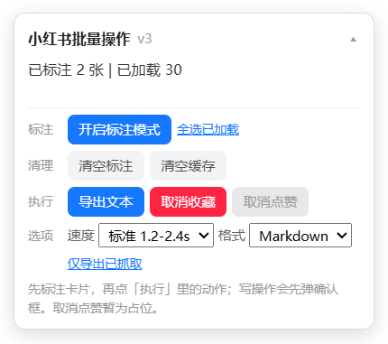

# 小红书批量操作助手（统一版）

一个脚本、一套标注交互、三个批量动作。选卡片、队列、限速、面板全部共用，
**只是「对这批卡片做什么」不同**。

> 适用于网页版（`xiaohongshu.com`）的 笔记 / 收藏 / 点赞 三个 tab。
> **所有写操作在执行前都会先弹对话框确认。**

---

## 三个动作

| 动作 | 类型 | 状态 | 作用 |
| --- | --- | --- | --- |
| **批量导出文本** | 只读 | 已完成 | 把每条笔记的原标题、正文、作者、日期、话题标签、链接 dump 到本地文件。 |
| **批量取消收藏** | 写 | 已完成 | 通过内部接口批量取消收藏，不用逐张开弹窗。 |
| **批量取消点赞** | 写 | 占位 | 仅保留入口，暂未实现，按钮灰显禁用。 |

### 写操作的确认门槛

任何写动作在真正发出第一个请求之前，都会弹出确认框，显示**动作名称、标注条数、
操作不可逆**的说明。点「取消」意味着**零请求发出、标注原样保留**（已在线上验证）。
首次执行取消收藏还会真实点开 1 张笔记来获取接口签名（该张也会被取消），确认框里
也写明了这一点。

「执行」行里每个动作各有一个按钮，**点一下就直接执行**，不再「先选下拉、再点开始」。
导出是蓝色、取消收藏是红色，整块面板只在写动作真正运行期间变红，避免误触。
安全的顺序是 **先导出备份、再取消收藏**——取消成功的条目会移出标注队列。

---

## 为什么要整合

之前两个独立脚本（批量取消收藏、笔记批量导出）把整套标注引擎复制了两遍：点击拦截、
角标、MutationObserver 补标、速度档位、存储。整合并不是把删除和只读混成一个按钮，
而是**共用底座、动作仍然分离**，以后加第三个动作也不用再复制一份面板。

---

## 标注机制（三动作共用）

1. 打开**标注模式**点卡片打标记，或用「全选已加载」，可边滚动边标。
2. 每条标注存 `{ noteId, 带 token 的链接, 卡片标题 }` 到 localStorage。瀑布流是
   虚拟列表、滚过去的卡片会被回收（实测 63 → 38），所以批处理**不依赖卡片还在 DOM**。
3. 选好速度，点「执行」行里的 **导出文本** 或 **取消收藏**，一下即执行（写动作先确认）。
4. 红色 `·` 角标 = 待处理，绿色 `✓` = 已处理。

---

## 安装

1. 安装 [Tampermonkey 油猴](https://www.tampermonkey.net/) 或
   [Violentmonkey](https://violentmonkey.github.io/)。
2. 导入 `xhs-batch-actions.user.js`（油猴 → 实用工具 → 导入），或新建脚本粘贴内容。
3. 打开已登录的小红书个人页 → 「收藏」或「点赞」，右下角出现**一个收起的小胶囊**。
   点击标题栏即可展开完整面板。每次打开页面都默认收起，不会一上来就挡住内容。

---

## 面板说明

面板只有三组按钮，外加一行小配置。

| 分组 | 控件 | 作用 |
| --- | --- | --- |
| — | **标题栏（点击）** | 折叠 / 展开。收起时仍显示标注数、「标注中」状态或执行进度；标注模式不会因收起而关闭。 |
| **标注** | **开启标注模式 / 退出标注模式** | 一个按钮两个状态；打开后点卡片标记 / 取消标记。 |
| **标注** | 全选已加载（文字链接） | 标记当前已加载的全部卡片；下滑后再点可追加。 |
| **清理** | **清空标注** | 只清选中项。 |
| **清理** | **清空缓存** | 清 localStorage 里已抓取的内容，标注保留；会先确认。 |
| **执行** | **导出文本**（蓝） | 点一下立即执行只读导出。 |
| **执行** | **取消收藏**（红） | 点一下立即执行，但会先弹确认框。 |
| **执行** | **取消点赞**（灰） | 占位，始终禁用。 |
| **选项** | 速度 / 格式 | 保守 2.2–4 秒 · 标准 1.2–2.4 秒 · 激进 0.6–1.2 秒；Markdown（默认）/ TXT / JSON / CSV。 |
| — | 仅导出已抓取（文字链接） | 下载缓存里的全部结果，包括之前批次。 |
| — | **暂停** | 仅在批处理运行时出现。 |

---

## 动作一：批量导出（只读）

每条标注的笔记用隐藏的同源 iframe 打开 `/explore/{noteId}?xsec_token=…`，
页面渲染 `#detail-title`、`#detail-desc`、`#detail-desc a.tag`、`.author`、`.date`；
脚本读完立刻删掉 iframe。**不开弹窗、不刷新页面、不滚动、不发任何写请求**。

四种格式都**以 post 原标题作为每条记录的标题**（不用 ID / 序号）：

- **Markdown**（默认）——`# 标题`，下面是作者、日期、话题标签、链接和完整正文，
  条目间以 `---` 分隔。
- **TXT** ——纯文本，每条一个信息头 + 正文。
- **JSON** ——`{ exportedAt, count, notes: [{ title, author, date, tags, desc, noteId, url }] }`。
- **CSV** ——列为 `title,author,date,tags,desc,noteId,url`，带 UTF-8 BOM，
  引号与换行均已转义。

文件：`xhs-notes-YYYYMMDD-HHMMSS.{ext}`，保存到浏览器下载目录。

---

## 动作二：批量取消收藏（写）

- 接口 `POST https://edith.xiaohongshu.com/api/sns/web/v1/note/uncollect`，
  body 为 `{"note_ids":"<id>"}`，必须 `withCredentials = true`（否则返回 `-101 未登录`）。
- 签名头（`X-s`、`X-t`、`X-S-Common` 等）从一次真实 uncollect 请求里捕获；
  签名只绑定 URL path、不绑 body，且时间戳不校验时效，因此一次捕获可用于所有笔记，
  并缓存 24 小时。
- 风控码 `300031 / 300012 / 4601` 会触发 60 秒冷却并重试几次，之后停止且保留剩余标注。
- 捕获签名需要至少一张标注卡片当前还渲染在列表里；若全被虚拟列表回收了，
  先滚回去让其中一张出现，脚本会明确提示而不会乱猜。

---

## 动作三：批量取消点赞（占位）

暂未实现：「执行」行里保留了该按钮，但灰显禁用，直接调用分发器也只会给出提示。
脚本里保留了 `runUnlike` 的 TODO 说明，写清了将来接入的步骤：找到真实的取消点赞接口、
为**那个 path** 单独捕获签名（不要复用 uncollect 的）、复用队列 / 限速 / 风控逻辑、
把 `ACTIONS.unlike.implemented` 改为 `true`，并且**必须保留确认门槛**。

---

## 数据存在哪里

| 阶段 | 存储位置 |
| --- | --- |
| 标注队列（id + 带 token 链接 + 卡片标题） | `localStorage['xhs_batch_marks_v1']` |
| 导出结果（标题、正文等） | `localStorage['xhs_batch_results_v1']`，每抓完一条就写入 |
| 签名头 | `localStorage['xhs_batch_sig_v1']` |
| 导出的文件 | **磁盘** ——真实下载文件，例如 `xhs-notes-20261111-004627.md` |
| 隐藏 iframe | 仅在内存，读完即删 |

- localStorage 跨刷新保留，导出时跳过已抓取条目，支持断点续跑。
- 配额约 5MB、且只在当前浏览器有效。**下载出来的文件才是持久副本**。
- 导出不会自动清空缓存，用完点「清空缓存」。

---

## 稳定性提示

- 失败条目自动重试一次，仍失败会保留标注可再执行。
- 导出每 60 条、取消收藏每 100 条自动休息一次，间隔随机。
- 列表很大时建议「保守」档位。
- `xsec_token` 可能过期：个别笔记反复失败时，刷新列表重新标注即可刷新链接。
- 只读动作不调用任何写接口，也绝不点击收藏 / 点赞按钮。

---

## 兼容性 / 自定义

- 匹配规则：`https://www.xiaohongshu.com/*`。
- 顶部的 `ACTIONS` 定义三个动作及 `write` / `implemented` 标记；确认门槛读的是
  `write`，所以以后新增写动作会自动带上确认框。
- 关键选择器在 `SEL`：`section.note-item`、`a.cover`、`.title`、`#detail-title`、
  `#detail-desc`、`#detail-desc a.tag`、`.author-wrapper .author`、`.date`、
  `.note-detail-mask`、`.collect-wrapper`、`.close-circle`。
  网站改版时请在 DevTools 里对照真实 DOM 重新确认这些选择器。

---

## 免责声明

仅供**个人使用**。使用风险自负；批量操作可能触发限流或临时限制。复用导出文本时请尊重
原作者及小红书的相关条款。
